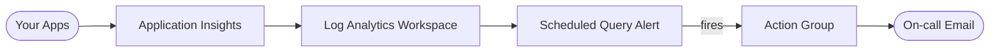

# Azure Monitor Observability (Terraform)

> Centralized monitoring on Azure: Log Analytics + Application Insights with a log-based alert and email action group — provisioned with Terraform.
> **Author:** Muhammad Ahmad · **IaC:** Terraform · **Cloud:** Azure


---

## 📌 Overview

- A **Log Analytics workspace** is the central log/metric store.
- **Application Insights** (workspace-based) collects app telemetry you wire into your services.
- A **scheduled query alert** runs a KQL query (exception count) every 5 minutes.
- When it fires, an **action group** emails the on-call address.

Drop the App Insights connection string into any app to start shipping telemetry here.

## 🏗️ Architecture

> 🎨 **Interactive diagram (industry-standard icons):** [open in Lucid — page 20](https://lucid.app/lucidchart/3da75ce3-ea66-4296-81b3-00d20a60435b/edit)



## 🚀 Deploy

```bash
cd terraform
az login
terraform init
terraform apply -var="alert_email=you@example.com"
```

## 🧹 Clean up

```bash
terraform destroy
```

## 💰 Cost note

Log Analytics bills per GB ingested; a small workspace with short retention is inexpensive.

## 🔐 Production hardening (next steps)

- Add **workbooks** and a shared dashboard.
- Add **metric alerts** (availability, latency) and **SLO** tracking.
- Route critical alerts to **PagerDuty / Teams** via the action group.

---

*Built and maintained by **Muhammad Ahmad**.*
