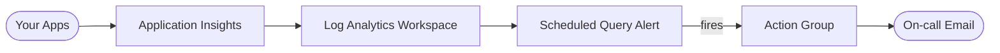

# Architecture Diagram — Azure Monitor Observability

## Lucid diagram

- **Master Lucid document (all 30 diagrams, icon style):** https://lucid.app/lucidchart/3da75ce3-ea66-4296-81b3-00d20a60435b/edit
- This project is **page 20** of that document.

## Lucid prompt (reusable)

```
Create an Azure monitoring diagram titled "Azure Monitor Observability".
Your Apps send telemetry to Application Insights, which stores data in a Log Analytics
Workspace. A Scheduled Query Alert runs over the workspace; when it fires it triggers
an Action Group that emails the on-call address. Label the arrows. Clean, professional
Azure colors.
```

## Mermaid source


