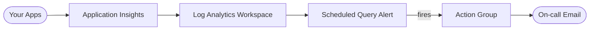

# Architecture Diagram — Azure Monitor Observability

## Lucid diagram

- **View:** https://lucid.app/lucidchart/75b71ba0-2155-4138-9e96-82b2bc03e8a3/view
- **Edit:** https://lucid.app/lucidchart/75b71ba0-2155-4138-9e96-82b2bc03e8a3/edit

## Lucid prompt (reusable)

```
Create an Azure monitoring diagram titled "Azure Monitor Observability".
Your Apps send telemetry to Application Insights, which stores data in a Log Analytics
Workspace. A Scheduled Query Alert runs over the workspace; when it fires it triggers
an Action Group that emails the on-call address. Label the arrows. Clean, professional
Azure colors.
```

## Mermaid source


